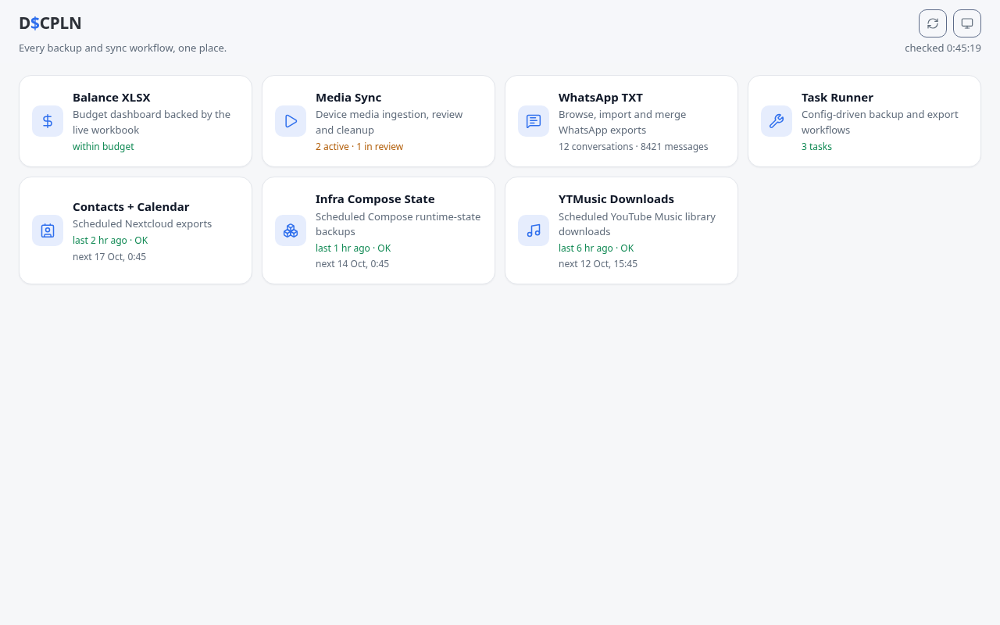
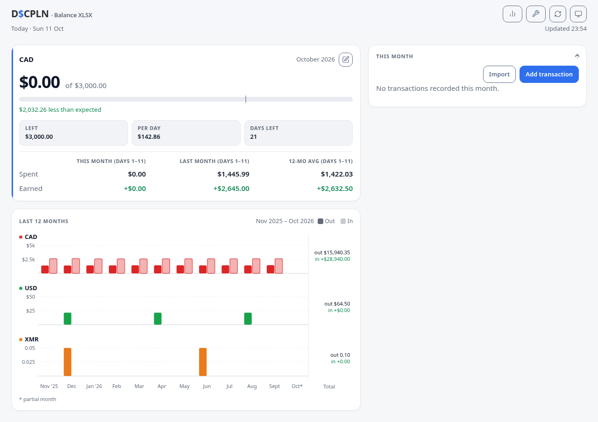
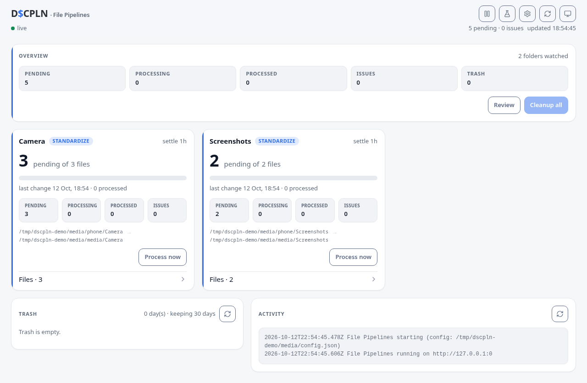
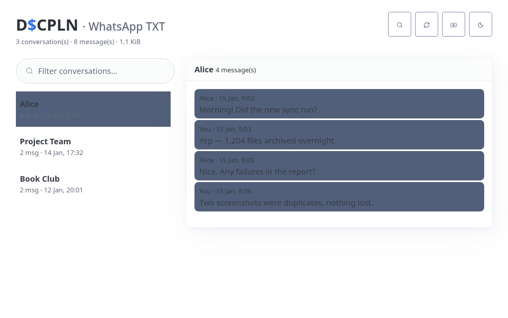
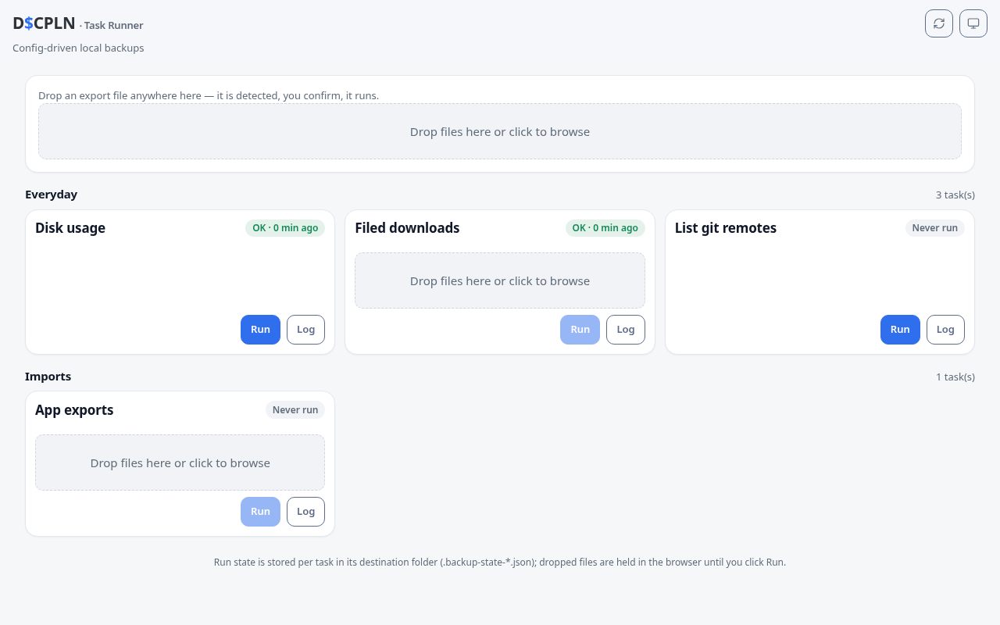
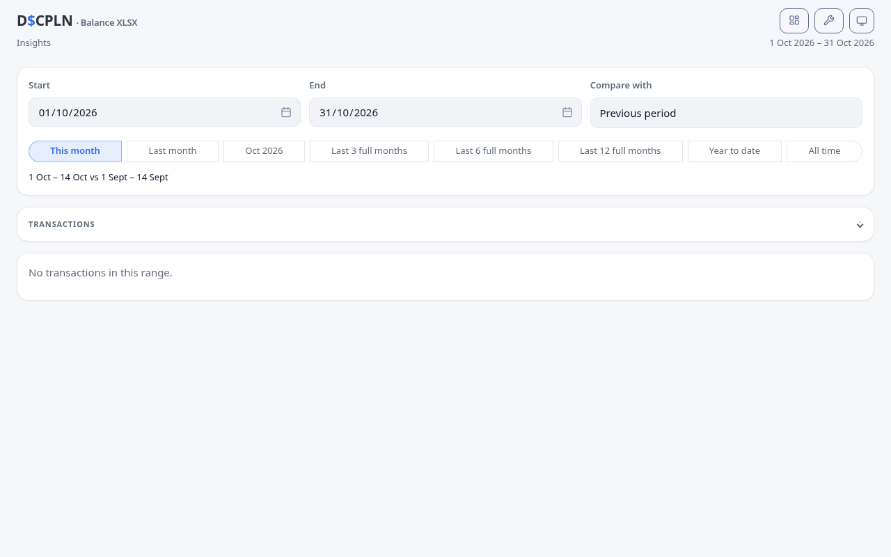
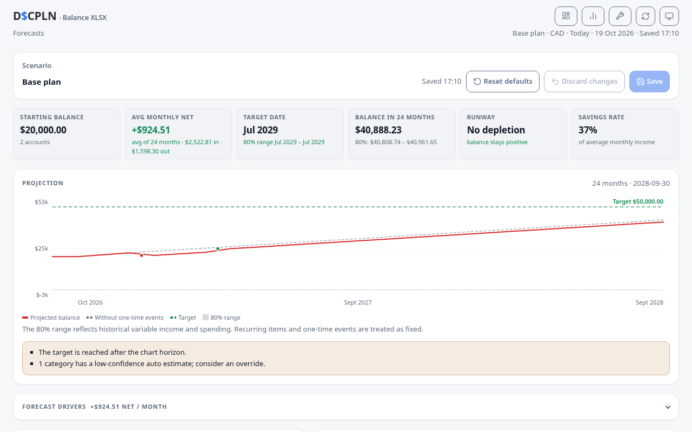

# D$CPLN

Every data backup and sync workflow in one place. D$CPLN is a monorepo of
small always-on Node apps — one per function — served behind a single host
(or on their own ports) with a portal at `/`.

| Function | Path | Description |
|---|---|---|
| [Portal](apps/portal/README.md) | `/` | Landing page linking every function with live status |
| [Balance XLSX](apps/balance-xlsx/README.md) | `/balance` | Budget dashboard, insights and a live forecast planner backed by an Excel workbook (external, token-protected API at `/balance/api`) |
| [File Pipelines](apps/file-pipelines/README.md) | `/pipelines` | Watches device folders, standardizes media, queues review/trash |
| [WhatsApp TXT](apps/whatsapp-txt/README.md) | `/watxt` | Browses, imports and merges WhatsApp chat exports |
| [Task Runner](apps/task-runner/README.md) | `/tasks` | Config-driven workflows: scheduled and on-demand bash tasks, drop zones, prompts, plus the scheduled Contacts/YTMusic jobs |

Each app's README covers its configuration fields, defaults and container
volumes; [`docs/ARCHITECTURE.md`](docs/ARCHITECTURE.md) covers the shared kits
and the base-path contract.

Every app is configured at runtime — through its own Settings UI or a mounted
config file — so nothing user-specific is baked into the apps or their images.
Run one app or all of them; each is an independent container.

The headless [Agent](apps/agent/README.md) extends the same model to remote
hosts: one generic archive-agent image, configured per host, with automatic
token enrollment. It lets the Task Runner replace broad SSH keys with a narrow
archive API.

## Keep your configuration in one repo

The apps work with their built-in defaults. For a multi-app deployment, put
your paths, tasks, schedules and app settings in a private `dscpln-config`
repository and mount it into the containers. A starter lives in
[`config-template/`](config-template/README.md):

```sh
npm run init-config -- ~/dscpln-config
# edit config.mjs, apps/*/config.json and secrets.json
```

The starter documents the per-app environment variables (`DSCPLN_CONFIG_FILE`,
`DSCPLN_CONFIG`, `BACKUPCTL_CONFIG_FILE`, `DSCPLN_STATE_FILE`) and a Docker
Compose mount example. Keep the repo private if it contains credentials, and
never commit `secrets.json`.

## Screenshots

All images use synthetic demo data — regenerate them with
`node scripts/screenshots.mjs`.

| | |
|---|---|
|  |  |
|  |  |
|  |  |
|  | |

## Run with Docker

Images are published as `ghcr.io/imranr98/dscpln-<app>` (portal, balance,
file-pipelines, watxt, task-runner). The headless remote agent is
`ghcr.io/imranr98/dscpln-agent`. All five app tags are built from the same
unified image; the deployment's `APP` env selects the server. CI publishes them
after every green `main` build and lists the digest to pin in the run summary.
`docker-compose.example.yaml` shows the expected volumes and ports for a few of
them:

```sh
docker run -p 8080:8080 ghcr.io/imranr98/dscpln-portal:latest
```

The images contain only the public app code and synthetic examples; runtime
config and secrets are never baked in. Apps keep their config/state in the
directories you mount (or on a Docker volume) and can be configured from their
Settings UI. When you put several apps behind one reverse proxy, set
`BASE_PATH=/<name>` (for example `/pipelines`) and route `/<name>` to that
container; otherwise leave it empty.

GHCR creates new packages private by default. After the first publish, make each
`dscpln-*` package public (package settings → Change visibility), or add an
`imagePullSecret` with `read:packages` to the deployment. Local builds push to
GHCR too; authenticate with a personal access token that has `write:packages`
(`docker login ghcr.io -u <user>`), or set `REGISTRY`/`IMAGE_ORG` to push
elsewhere.

## Development

Requires Node 26+.

```sh
npm install            # installs every workspace
npm test               # builds every UI and runs every test suite
npm run ui             # build all UIs only
npm run balance-xlsx   # start Balance XLSX locally (http://localhost:3300)
npm run task-runner    # ...or any app by name
```

Each app has an `apps/<app>/ui/` front end (React + Vite, built into the
app's `static/`) served by a small express server from `packages/server-kit`.
See `docs/ARCHITECTURE.md` for the kit APIs, the base-path contract, the
Operations runbook and the new-app recipe.

## Safety

These apps drive backups of personal data, so the conventions matter: never
delete user data, write config/state atomically (`0600`), verify before
overwriting, keep on-disk formats stable, and treat secrets as write-only
(they are masked in API responses and stored on the app's private volume).

Published images contain the public app code and synthetic examples only.
Runtime config, secrets and data belong on mounted volumes (see
[`config-template/`](config-template/README.md)) and must never be copied into
`apps/` or `packages/`; the image build also excludes the usual runtime files.
