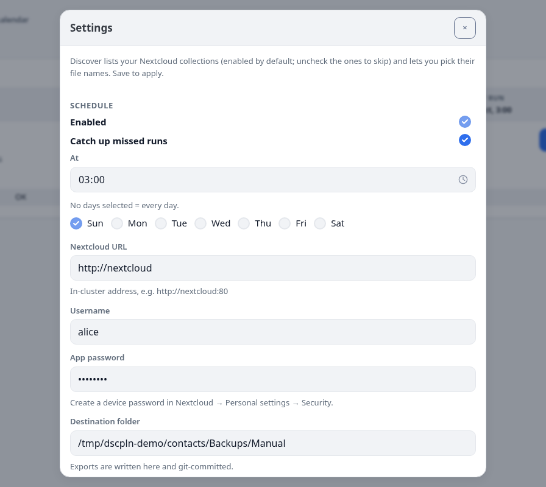
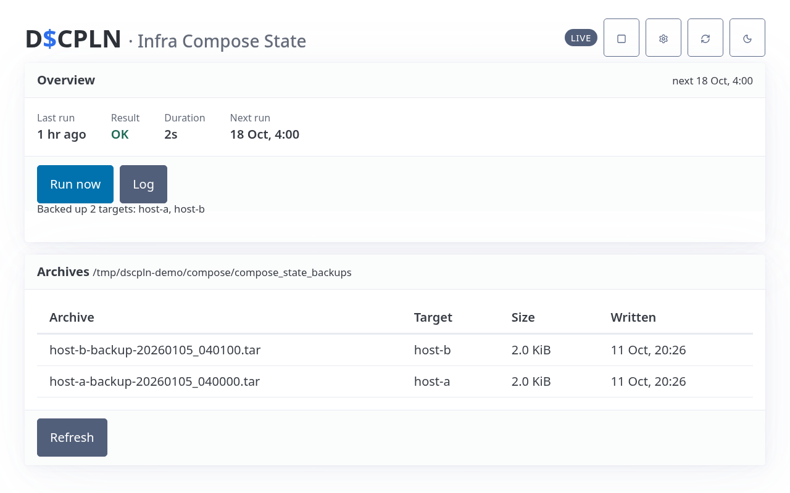
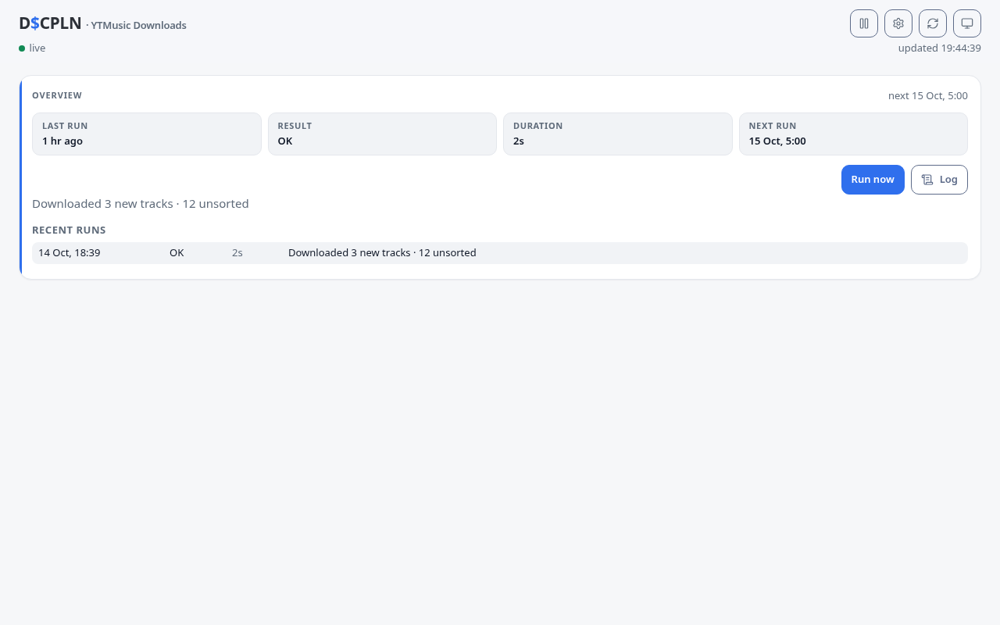
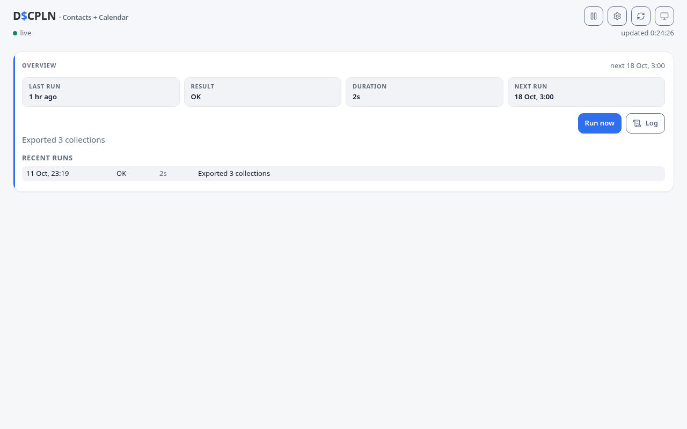

# D$CPLN

Every data backup and sync workflow in one place. D$CPLN is a monorepo of
small always-on Node apps — one per function — served behind a single host
(or on their own ports) with a portal at `/`.

| Function | Path | Description |
|---|---|---|
| [Portal](apps/portal/README.md) | `/` | Landing page linking every function with live status |
| [Balance XLSX](apps/balance-xlsx/README.md) | `/balance` | Budget dashboard backed by an Excel workbook (external, token-protected API at `/balance/api`) |
| [File Pipelines](apps/file-pipelines/README.md) | `/pipelines` | Watches device folders, standardizes media, queues review/trash |
| [WhatsApp TXT](apps/whatsapp-txt/README.md) | `/watxt` | Browses, imports and merges WhatsApp chat exports |
| [Task Runner](apps/task-runner/README.md) | `/tasks` | Config-driven backup/export workflows (bash tasks, drop zones, prompts) |
| [Contacts + Calendar](apps/contacts-calendar/README.md) | `/contacts` | Scheduled Nextcloud contacts/calendar exports |
| [Infra Compose State](apps/compose-state/README.md) | `/compose` | Scheduled Docker Compose runtime-state backups |
| [YTMusic Downloads](apps/ytmusic/README.md) | `/ytmusic` | Scheduled YouTube Music library downloads |

Each app's README covers its configuration fields, defaults and container
volumes; [`docs/ARCHITECTURE.md`](docs/ARCHITECTURE.md) covers the shared kits
and the base-path contract.

Every app is configured at runtime — through its own Settings UI or a mounted
config file — so nothing user-specific is baked into the apps or their images.
Run one app or all of them; each is an independent container.

## Screenshots

All images use synthetic demo data — regenerate them with
`node scripts/screenshots.mjs`.

| | |
|---|---|
|  |  |
|  |  |
|  |  |
|  |  |
|  |  |

## Run with Docker

Images are published as `imranrdev/dscpln-<app>` (portal, balance, file-pipelines,
watxt, task-runner, contacts, compose, ytmusic). `docker-compose.example.yaml`
shows the expected volumes and ports for a few of them:

```sh
docker run -p 8080:8080 imranrdev/dscpln-portal:latest
```

Apps keep their config/state in the directories you mount (or on a Docker
volume) and can be configured from their Settings UI. When you put several apps
behind one reverse proxy, set `BASE_PATH=/<name>` (for example `/pipelines`) and
route `/<name>` to that container; otherwise leave it empty.

## Development

Requires Node 22+ (24 recommended).

```sh
npm install            # installs every workspace
npm test               # builds every UI and runs every test suite
npm run ui             # build all UIs only
npm run balance-xlsx   # start Balance XLSX locally (http://localhost:3300)
npm run ytmusic        # ...or any app by name
```

Each app has an `apps/<app>/ui/` front end (React + Vite, built into the
app's `static/`) served by a small express server from `packages/server-kit`.
See `docs/ARCHITECTURE.md` for the kit APIs, the base-path contract, the
Operations runbook and the new-app recipe.

## Safety

These apps drive backups of personal data, so the conventions matter: never
delete user data, write config/state atomically (`0600`), verify before
overwriting, keep on-disk formats stable, and treat secrets as write-only
(they are masked in API responses and stored on the app's private volume).
